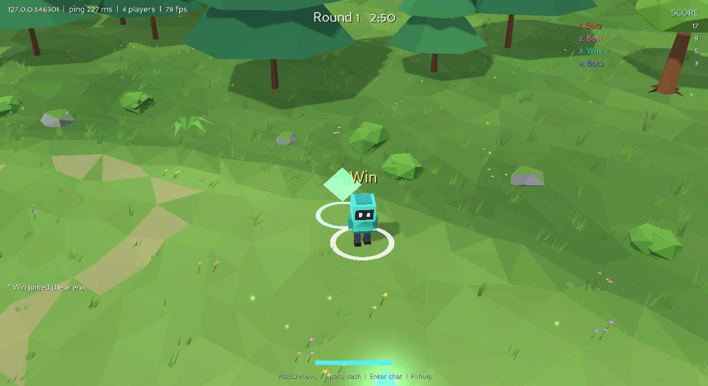

# Panda Arena

A small online arena game built on **Panda3D 1.10.16** (latest release) and its
[distributed networking](https://docs.panda3d.org/1.10/python/programming/networking/distributed/index)
system. The client is **C++**, compiled with **g++** on Linux and Windows (MinGW-w64)
and with the Android NDK's clang for **Android** phones and tablets, and the dedicated
server is **Python**.




*The Windows client (MinGW-w64 g++ build, shown here running under Wine with software
OpenGL) against the Python server and three bots.*

A sunny meadow in a forest valley: collect glowing gems (mint = 1 point, gold = 5), and
dash into other players to steal 2 of their points. When the round timer runs out, the highest score wins, and a new
round starts a few seconds later. Up to 16 players per server (configurable).

---

## Quick start

```bash
# Server (any OS with Python 3.8+)
pip install -r server/requirements.txt           # panda3d==1.10.16
python server/arena_server.py                    # listens on 0.0.0.0:4400

# Client (after building, see below)
build/linux/bin/arena_client --host <server-ip> --name Alice        # Linux
build\mingw\bin\arena_client.exe --host <server-ip> --name Alice   # Windows
adb install -r build/android-arm64/bin/PandaArena.apk              # Android
```

Open TCP port 4400 on the server's firewall (or pick another with `--port`), and UDP 4400
so phones and PCs on the same network find the server by themselves. Every player runs
the client against the same host.

| Key | Action |
|---|---|
| WASD / arrows | move |
| Space | dash (1.6 s cooldown) |
| Enter | chat (Enter sends, Esc cancels) |
| Mouse wheel | zoom |
| F1 / F3 / F11 | help / network statistics / fullscreen |
| Esc | quit |

On Android: the stick sits in the bottom-left corner and stays there; put your thumb on
it and push the knob (direction only: you always run at full speed, like with the keys).
The DASH button in the bottom-right corner dashes when the button itself is touched, and
shows the cooldown. Two fingers elsewhere on the right half pinch to zoom; tapping the
status line shows network statistics. Back opens the menu (the connect screen) over the
game, which goes on behind it, still connected: Back or RESUME returns to it, and only
joining another server leaves it. Back on the menu without a game closes the app.

---

## Building the client

The client is built with **g++** on both systems. CMake downloads the Panda3D 1.10.16
source and compiles the parts the game uses (core, OpenGL, the window system, the
framework) with the same g++, then links them **statically**. No Panda3D SDK is
needed, and the result is one self-contained executable (~10 MB stripped) per platform.
The first build takes a few minutes; later builds only recompile the game.

| | Linux | Windows |
|---|---|---|
| Compiler | g++ 12 or newer (C++20; tested: 13) | MinGW-w64 g++ 12 or newer (tested: 13, 16.1) |
| Window / GL | X11, GLX | Win32, WGL |
| Executable needs | libGL, libX11 (and FreeType, if the system's is used) | only DLLs that ship with Windows |

### Linux (g++)

```bash
sudo apt install build-essential cmake ninja-build git libgl-dev libx11-dev libfreetype-dev
cmake --preset linux-gcc
cmake --build --preset linux-gcc
ctest --preset linux-gcc            # Python tests need: pip install -r server/requirements.txt
build/linux/bin/arena_client --host 192.168.1.20
```

### Windows (MinGW-w64 g++)

You need a **current MinGW-w64 g++ (12 or newer; tested: 13 and 16.1)**, CMake, Ninja, Git
and Python 3. Older toolchains such as the GCC 11.1 bundled with Nim fail inside their own
headers, so CMake stops with a message if it finds one.

**WinLibs (recommended: no installer, one folder, includes CMake and Ninja).**
1. On [winlibs.com](https://winlibs.com), under *Release versions* → *UCRT runtime*,
   download **GCC 16.1.0 (with POSIX threads) + MinGW-w64 14.0.0 (UCRT), Win64**, the
   archive *without LLVM/Clang/LLD/LLDB*: the .zip (about 270 MB; Windows opens it) or
   the .7z (110 MB; needs 7-Zip). Direct link to the .zip:
   <https://github.com/brechtsanders/winlibs_mingw/releases/download/16.1.0posix-14.0.0-ucrt-r3/winlibs-x86_64-posix-seh-gcc-16.1.0-mingw-w64ucrt-14.0.0-r3.zip>
2. Extract it anywhere, for example `C:\winlibs` (`tar -xf winlibs.zip -C C:\winlibs` in
   `cmd.exe`), which gives `C:\winlibs\mingw64\bin\g++.exe`. A folder with spaces such as
   `C:\Program Files\...`, or over Nim's MinGW (`C:\Program Files\nim-2.2.2_64\dist\mingw64`),
   works too: GCC cannot link from a path with a space on its own (`ld: cannot find
   C:/Program`), so CMake then links with a small specs file that fixes it
   (`cmake/MinGWPathWithSpaces.cmake`; the configure output says so).
3. Put its `mingw64\bin` on the PATH **before** any other MinGW (if you extracted over Nim's
   MinGW, it already is, and Nim uses this GCC too):
   `Win+R` → `sysdm.cpl` → *Advanced → Environment Variables* → *System variables* →
   `Path` → *Edit* → *New*, then *Move up* to the top. System entries come before user
   entries. Or for one `cmd.exe` session: `set PATH=C:\winlibs\mingw64\bin;%PATH%`.
4. Install [Git for Windows](https://git-scm.com/download/win) and
   [Python 3](https://www.python.org/downloads/) (tick *Add python.exe to PATH*).
5. In a **new** terminal, check: `where g++` lists that folder first and
   `g++ --version` says 16.1.0.

**MSYS2 (alternative).** Install [MSYS2](https://www.msys2.org), open the **UCRT64** shell
and run
`pacman -S --needed git mingw-w64-ucrt-x86_64-gcc mingw-w64-ucrt-x86_64-cmake mingw-w64-ucrt-x86_64-ninja mingw-w64-ucrt-x86_64-python`.

Then, in the `arena` folder (after switching compilers, delete the old `build\mingw`
folder first: CMake remembers the compiler it found):

```bat
rmdir /s /q build\mingw
cmake --preset windows-mingw
cmake --build --preset windows-mingw
ctest --preset windows-mingw
build\mingw\bin\arena_client.exe --host <local_ip>
```

### Windows .exe from Linux (cross-compile)

```bash
sudo apt install g++-mingw-w64-x86-64-posix wine    # wine only to run the tests
cmake --preset windows-mingw-cross
cmake --build --preset windows-mingw-cross
ctest --preset windows-mingw-cross                  # runs the .exe files through Wine
```

### Android (phones and tablets)

The same game runs on Android 7.0 (API 24) and newer with OpenGL ES 3. The whole client,
Panda3D included, is one library, `libarena.so`, that Android's NativeActivity runs; there
is no Java code. It is built with the same CMake and the Android NDK's **clang**: Google
removed GCC from the NDK in 2019 (r18), so g++ is not an option there.

What is different on a phone:

* **Renderer:** Panda3D's OpenGL ES renderer (`gles2gsg`) in its Android window
  (`androiddisplay`). makepanda only builds that window for OpenGL ES 1, so
  `cmake/Panda3DFromSource.cmake` builds it for ES 2/3 itself. Patches 0003 to 0005
  (`cmake/panda3d-patches/`) fix what that needed: shadow-map depth textures on ES, keeping
  the GL context while the app is in the background, asking for an ES 3 context,
  `ALooper_pollAll` (gone from current NDKs), a failed internal check logging instead of
  closing the app, and full precision in Panda's built-in shader (what draws everything
  with shaders off: the player's ring, the glows, text). Its `mediump` is 16 bits on phone
  GPUs (Mali, Adreno), too coarse for positions: flat effects a few centimetres above the
  ground showed through it there, though not on PCs or emulators. The shaders are the same
  files: on OpenGL ES the GLSL 1.50 source is compiled as GLSL ES 3.00, which only needs
  another version line and precisions. The shadow map is 1024².
* **Full screen:** immersive mode hides the navigation buttons and the status bar (a swipe
  from the edge shows them for a moment), and the game also draws beside a camera cutout.
  Android only lets its UI thread do that, so `AndroidMain.cpp` has the activity's entry
  point (`ANativeActivity_onCreate`, calling the app glue's under another name) and hooks
  the activity's resume and focus callbacks, which run there.
* **Controls:** the touch controls above, sized for the screen (the 2D interface grows on
  small screens).
* **Connect screen** (also the menu, on Back, over the game): servers on the same network
  appear by themselves. A probe on UDP 4400 is answered by `server/arena/discovery.py`;
  replies are never larger than the probe and are rate-limited, so the port cannot amplify
  floods. Otherwise tap the address field and type on the phone's keyboard: an address or a
  host name (`192.168.1.20`, `arena.example.com`, `arena.example.com:4401`); Enter or PLAY
  joins. The server you are on shows RESUME instead: still connected, nothing to join. The
  last server and your name are remembered. (NativeActivity's view cannot take the focus
  on its own, and the keyboard only comes up for the focused view, so `AndroidMain.cpp`
  makes it focusable, also in touch mode.)
* **Resources:** `arena.pak` ships inside the APK (`assets/`) and is decrypted in memory
  like on the PC.
* **In the background** (Home, the app switcher, the screen off) the game stops drawing as
  soon as Android pauses it, before the window's surface goes away, and stays connected
  for 15 s. Back within that time, the game simply goes on; later, it has left the server
  and joins it again by itself. The server drops a player it has not heard from for 15 s
  (clients ping every 2 s), e.g. a phone that Android froze in the background.
* **Only in the Android build:** the touch controls, the connect screen, LAN discovery,
  settings and Android's input and lifecycle (`ARENA_PHONE_SOURCES`, `AndroidMain.cpp`,
  `Platform.cpp` in `CMakeLists.txt`; the code using them in `App.cpp` and `Hud.cpp` is
  `#ifdef __ANDROID__`). The PC client has none of it; the unit tests still build the
  platform-independent parts on the PC.

What you need, once (easiest with [Android Studio](https://developer.android.com/studio):
*Tools → SDK Manager*):

* *SDK Platforms:* one Android version, e.g. Android 15 (API 35);
* *SDK Tools:* **NDK (Side by side)** r27 or newer, **Android SDK Build-Tools**,
  **Android SDK Platform-Tools** (adb);
* a JDK 17+ for signing: Android Studio has one in its `jbr` folder;
* CMake, Ninja, Python 3 and Git, as for the PC builds.

Without Android Studio, the [command-line tools](https://developer.android.com/studio#command-line-tools-only)
install the same: `sdkmanager "platforms;android-35" "build-tools;35.0.0" "ndk;27.2.12479018" "platform-tools"`.

```bat
:: Windows (cmd.exe)
set ANDROID_HOME=%LOCALAPPDATA%\Android\Sdk
set JAVA_HOME=C:\Program Files\Android\Android Studio\jbr
cmake --preset android-arm64
cmake --build --preset android-arm64
adb install -r build\android-arm64\bin\PandaArena.apk
```

On Linux it is the same with `export ANDROID_HOME=~/Android/Sdk` and so on. The newest
NDK in `%ANDROID_HOME%\ndk\` (by the version in its `source.properties`, whatever the
folder is called) is used (`cmake/toolchains/android.cmake`; the configure output names
it); set `ANDROID_NDK_HOME` to pick another. Android builds compile at `-O2` without debug
info rather than the NDK's `-O3 -g`. If the NDK's clang itself crashes ("PLEASE submit a
bug report", `Exception Code: 0xC0000005`), as NDK r27d's clang 18.0.4 did on Windows on
FreeType files, install a newer NDK with the SDK Manager, delete `build\android-arm64` and
configure again.

* The build makes `bin/PandaArena.apk` (`tools/make_apk.py`: aapt2, zipalign, apksigner;
  the launcher icon is drawn by the script). It is signed with a debug key made on the first
  build, `bin/debug.keystore`. Keep it: Android only installs an update signed with the
  same key.
* Install with `adb install -r` (enable *Developer options → USB debugging* on the phone),
  or copy the APK to the phone and open it there (allow installing unknown apps).
* Play: run the server on a PC on the same Wi-Fi, with TCP and UDP 4400 allowed in its
  firewall. The phone lists it; tap it.
* Logs: `adb logcat -s PandaArena Panda3D`.
* `--preset android-x86_64` builds for the emulator and Chromebooks. For a store release,
  sign with your own key: `-DARENA_ANDROID_KEYSTORE=release.keystore
  -DARENA_ANDROID_KEY_ALIAS=<alias>`, with the password in the `ARENA_KEYSTORE_PASS`
  environment variable.
* `--preset linux-gles` builds the Linux client with the OpenGL ES renderer Android uses
  (EGL; Mesa runs it everywhere), to try that renderer on a PC.
* The build folder remembers the NDK it found (`ARENA_ANDROID_NDK`), so later builds work
  from a console without `ANDROID_HOME` or `ANDROID_NDK_HOME`.

### Build notes

* `cmake/Panda3DFromSource.cmake` mirrors the file lists, defines and flags of Panda3D's
  own `makepanda.py` (`-std=gnu++11 -fno-exceptions -ffast-math -O2 ...`). Panda3D's
  build system has no MinGW target, so `cmake/panda3d-patches/0001-mingw-w64.patch` adds
  the five small portability fixes it needs (e.g. `dlfcn.h`, `msvcrt` time zone,
  duplicate XInput declarations); it is applied automatically.
* `-DPANDA3D_SOURCE_DIR=/path/to/panda3d` reuses an existing 1.10.16 checkout instead of
  downloading one. FreeType is taken from the system on Linux and otherwise built from
  source (`-DARENA_PANDA3D_SYSTEM_LIBS=ON/OFF` to choose).
* Compiler options follow the main project's rules (`docs/GUIDE.md` §6,
  `cmake/CompilerOptions.cmake`). The game code uses `-O3`, LTO, the safe fast-math subset
  (`ARENA_FAST_MATH`, which keeps NaN/Inf) and `-fno-plt`. `-DARENA_X86_64_V3=ON` targets
  AVX2/FMA (CPUs since 2013). It is off by default so the `.exe` runs everywhere.
  Profile-guided optimisation: configure with `-DARENA_PGO=GEN`, build, play or run
  `arena_client --bot` for a few minutes, then reconfigure with `-DARENA_PGO=USE` and
  build again.
* `--preset linux-gcc-sdk` links an installed Panda3D C++ SDK instead (the
  [.deb](https://www.panda3d.org/download/) or a `makepanda` build; `-DPANDA3D_ROOT=...`).
  The official Windows SDK is compiled with MSVC, whose C++ ABI g++ cannot link against,
  so on Windows Panda3D is always built from source.
* The build packs the DC files and shaders into `bin/arena.pak` (see *Resources*), which
  needs Python 3 (standard library only). Without Python the files are copied next to the
  client unencrypted instead.

### Resources: an encrypted Multifile

The client's resources (`common/direct.dc`, `common/arena.dc`, `client/shaders/*`) ship
in `arena.pak` next to the executable, never as readable files. `tools/make_pack.py`
writes them into a Panda3D [Multifile](https://docs.panda3d.org/1.10/python/programming/advanced-loading/multifiles)
and encrypts the whole Multifile with ChaCha20 (RFC 8439). At start-up the client
decrypts it in memory and mounts it read-only at `/arena` in Panda's virtual file system
(`client/src/core/ResourcePack.cpp`). The DC parser and the shader loader then read
`/arena/dc/arena.dc` and so on like ordinary files, and nothing decrypted is ever written to
disk. A pack made with another key, or a damaged one, is refused with a clear message.

* Panda's own Multifile encryption (`set_encryption_flag`) needs OpenSSL, which the
  g++-built Panda3D, and the static Windows `.exe` in particular, does not include. So the
  Multifile is encrypted as a whole instead, with the same code in C++ and Python, both
  checked against the RFC's test vector.
* The key: `-DARENA_PACK_KEY=<64 hex digits>` (e.g. one key for all your releases). By
  default every build folder gets its own random key, kept in its CMake cache. The
  executable holds it as key XOR mask plus mask, so it is not one string in the binary.
* What this protects: the files cannot be read or edited casually, and changing them breaks
  the client. It cannot stop someone who takes the executable apart with a debugger. No
  client-side encryption can, because the client must decrypt to run. It does not need to,
  either: the server checks the DC hash at login and validates everything players send. The
  server reads the plain DC files, which stay on the server.
* `--pack FILE` loads another pack; `--dc-dir DIR` loads plain DC files (development).

### Panda3D settings (PRC)

The client builds its Panda3D configuration in (`configure()` in `client/src/app/App.cpp`)
and sets only what changes something for this game. Most performance variables are
already at their best by default (state and transform caches, vertex buffers, pre-munged
vertex data, deferred state garbage collection). The model, texture-loading and audio
variables do not apply: the world is generated at start-up from code, with no model or
texture files.

| Setting | Why |
|---|---|
| `color-bits 8 8 8`, `depth-bits 24`, `framebuffer-stencil #f` | never a 16-bit screen (banding in the sky) or a 16-bit depth buffer (flickering distant hills), which phones may pick unless asked; no stencil, it is not used |
| near plane 1 m (camera lens) | twice the depth precision of 0.5 m; the camera is always 15 m or more from what it shows |
| `gl-validate-shaders #f` (on with `--verbose`) | validation only prints diagnostics, and stalls the first frame |
| `text-minfilter linear_mipmap_linear`, `text-page-size 512 512` | small HUD text stays crisp instead of shimmering, and all its glyphs fit on one or two textures (fewer draw calls) |
| `sleep-precision 0` with `clock-mode limited` | headless clients and phones sleep between frames instead of spinning the last 10 ms of each |
| Android: one window attempt with `BF_fb_props_optional` | the closest framebuffer config is taken (a phone without 24-bit depth still opens); Panda's Android window cannot be opened a second time after a failed attempt |
| Android: `clock-frame-rate 60`, 4x MSAA where the phone offers it | 90/120 Hz phones draw half the frames, staying cool and at full clock speed; phone GPUs (Mali, Adreno) draw in tiles in on-chip memory and resolve the samples there, so smooth edges cost little, far less than a post-process anti-aliasing pass (FXAA or a "denoise" filter reads and writes the whole screen again every frame). Without a 4x config the closest one is taken |

OpenGL ES builds (Android, `linux-gles`) set `load-display pandagles2` with
`aux-display pandagles` and `aux-display p3tinydisplay` as fallbacks, as Panda3D's Android
guide recommends (`pandagles2` is the renderer for shaders). The game always draws with
`pandagles2`: Panda3D is compiled into the client, the OpenGL ES 2/3 renderer
(androiddisplay with gles2gsg; egl on Linux) is the only renderer compiled into those builds,
and it registers itself while the program loads, so Panda never looks for plugin files.
`pandagles` (OpenGL ES 1) and `p3tinydisplay` (software) are not in the Android build at all.
The log shows which renderer and framebuffer the game got (`renderer:` and `window opened`).
Desktop OpenGL builds name no `load-display`: in a Panda3D SDK build it would load the OpenGL
ES plugin, which the desktop GLSL shaders do not run on.

`threading-model` (a separate cull/draw thread) is marked experimental in 1.10 and stays
off; it would also add a frame of input delay.

### Graphics

The world is generated at start-up as low-poly, flat-shaded geometry with vertex colours
(`client/src/game/Scenery.cpp`, no model files). It has a sunny meadow with paths,
pebbles and flowers; mossy boulders and an old stump with mushrooms (the obstacles); and
a bank of ferns, bushes and stones at the edge. Around it is a forest valley of broadleaf
and pine trees and rocky outcrops on rising hills. The side toward the camera only has low
plants, so nothing hides the players. All of it is two vertex buffers (about 283,000
vertices, two draw calls), built in about 20 ms.

GLSL shaders (`client/shaders`, loaded from the pack), in the spirit of
[3D Game Shaders For Beginners](https://github.com/lettier/3d-game-shaders-for-beginners):
* **world**:
  * a soft, slightly banded sun with **shadow maps** (Panda's directional-light shadow
    camera, sampled with 4-tap PCF);
  * sky/ground **hemisphere ambient**;
  * **cloud shadows** drifting across the ground;
  * a **rim light** that separates shapes;
  * **wind** that sways grass, ferns, flowers and leaves (per-vertex weights);
  * **distance haze** into the horizon colour;
  * lighting in linear colour with a soft highlight shoulder, and a dither of half a colour
    step against banding on 8-bit screens.
* **sky**: a dome with a blue-to-haze gradient (dithered too), a sun with glow, and slow fbm
  clouds.

The players are blocky characters with a visor and eyes, in their colour. Their walk cycle
comes from how fast they are drawn moving: legs and arms swing, and the body bobs and
leans into the run. Dashes stretch them and kick up dust, and hits flash them. Their bodies
turn toward where they move like the local player's does. Gems float, spin and glow (the
halo faces the camera, moved toward it by its radius so the ground never cuts it).
Butterflies flutter over the meadow and pollen drifts in the sun.

Performance choices (as in the main project): static scenery is batched into two vertex
buffers filled with one copy each (non-indexed); thin things (grass, effects, labels) are
hidden from the shadow camera, and the shadow pass renders depth only without the shaders;
the shadow frustum covers just the arena and the trees around it (2048² by default); per
frame only the players, gems and a few dozen particles move.

Options: `--zoom 0.55..1.6` sets the start view (closer is lower, like over a shoulder;
the mouse wheel changes it), `--no-shadows` keeps the shaders without the shadow map, and
`--low` uses fixed-function lighting (the same scene, no shadows). If the driver has no
GLSL, or the shaders do not compile on it, the client falls back to fixed-function by itself.
Window creation falls back from 4x MSAA, to no MSAA, to a software OpenGL framebuffer (VMs
and remote desktops).

---

### Start-up logo

Like games made with Unreal show theirs, the client first shows the engine's logo: the
Panda3D head and "PANDA3D" in white on the logo's grey (#252525), fading in, for at least
1.8 s, then fading out (`client/src/game/SplashScreen.cpp`). The game loads behind it: the
world is built, the shaders compile on the first frames, a joining client connects and the
phone's menu looks for servers. Nothing under it takes input. `--no-splash` leaves it out
(automation); headless clients never show it. On Android the window Android shows while
the app starts is the same grey (`values/theme.xml`, written by `tools/make_apk.py`), so
there is no flash between it and the logo.

None of it is a picture, so it is sharp on any screen size and shape:

* the head is polygons: traced from Panda3D's own icon (`panda/src/configfiles/pandaIcon.ico`
  in the Panda3D repository, its 256 px image), mirrored and averaged (the logo is
  symmetric), with the white outline the logo has on dark backgrounds. Two white shapes,
  under 60 triangles, triangulated by Panda's `Triangulator` at start-up; the dark parts
  are holes, so fading works over anything. Edges are smooth with MSAA (on by default on
  PCs and phones);
* the word is the logo's typeface, Roboto Bold (a Panda3D forum reply names it; its stem
  weight matches the logo's), set as tightly as the logo, whose older Roboto was narrower.
  Panda renders its glyphs with FreeType at exactly the size they are drawn, so they are
  crisp from 720p to 4K. `client/fonts/Roboto-Bold.ttf` is cut down to the letters of the
  word (2.8 KB; `pyftsubset Roboto-Bold.ttf --text="PANDA3D "`), Apache 2.0
  (`client/fonts/LICENSE-Roboto.txt`), and ships in `arena.pak`;
* the background is a plain card over the whole window.

What the alternatives would cost (measured on the test machine; phones decode several
times slower):

| Splash | Memory on the GPU | Before the first frame | Sharpness |
|---|---|---|---|
| this one: polygons + font + card | under 60 triangles and one glyph page (512² at 1080p, 1 byte per texel: 0.25 MB) | a 2.8 KB font and a few hundred points to triangulate | exact at any size |
| one image of logo and word, 1920x1080 | 7.9 MB (RGBA, +2.6 MB mipmaps) | decoding the PNG: 24 ms | soft on larger screens |
| the same, 2560x1440 | 14.1 MB (+4.7 MB) | 49 ms | soft on 4K |
| the same, 3840x2160 | 31.6 MB (+10.5 MB) | 111 ms | exact, but the most memory and the slowest start |

A full-screen image also has to be letterboxed or cropped for every screen shape, and its
decoding delays exactly the frame that should appear at once. The other resolution-
independent way is a signed distance field texture (Valve, SIGGRAPH 2007): a small
texture of distances to the edges, drawn with a threshold. It needs no MSAA for smooth
edges, but a texture and a shader; for one flat logo the polygons are simpler and cheaper.

## How the networking works

The game follows the manual's architecture: one **ServerRepository**, one **AI repository**
(a `ClientRepository` with `dcSuffix='AI'`, see *AI Repositories*), and client repositories.
The AI is the authority: it creates every player, moves every player and decides every
pickup and hit. A client only says what its player wants to do.

```
 C++ client ──┐   inputs ▶                    ┌─────────── arena_server.py (one process) ─────────┐
 C++ client ──┼── TCP 4400 ──▶ ArenaServerRepository ◀── loopback ──▶ ArenaAIRepository         │
 Python bot ──┘   ◀ positions  (relay, validation, │                       TimeManagerAI     zone 1 │
                                limits)          │                       DistributedArenaGameAI 2 │
                                                 │                       (simulates every player) │
                                                 └────────────────────────────────────────────────┘
```

* **DC files** (`common/direct.dc` pinned from 1.10.16, `common/arena.dc`) define the
  distributed classes. Server, AI, C++ and Python clients load the same two files in the
  same order. The DC hash is checked during the handshake.
* **Connect flow** (as in *Client Repositories*): connect → hello → `SET_DOID_RANGE` →
  interest in zone 1 → the `TimeManager` syncs the clock → interest in zones 1+2 → the
  client sees `DistributedArenaGame` and **asks to join** (`requestJoin`, with the name and
  color it would like). The AI cleans the name up, creates the `DistributedArenaPlayer`
  where it chooses (a free spot, facing the centre), gives it a one-byte **slot** and tells
  the client which player is its own (`joined`). A client cannot create any object.
* **Inputs, only when they change** (`CLIENT_INPUT`, 10 bytes on the wire): which way the
  player steers (in 256ths of a turn, or not at all) and the dash button. A client sends
  one when the player presses, releases, dashes or turns by more than 2.8° (at most 30
  turns a second), and nothing while it holds a direction or stands still. Every input
  names the 120 Hz **step** it starts at, on the shared network clock.
* **The AI moves everyone** (`server/arena/simulation.py`) with the same movement code
  as the client (`server/arena/motion.py` is a line-by-line twin of
  `client/src/game/Movement.cpp`; a reference trajectory with dashes, a knockback, a pillar
  and the wall checks both agree). It runs each player a few steps behind real time: as
  late as that client's recent inputs arrived (but for the latest one), plus a step. So it
  applies nearly every input at exactly the step the client named. An input later than
  that is applied at the next step it simulates, and one claiming to come from more than
  0.2 s in the future is not believed. Positions, speeds, dashes, pickups and hits never
  come from a client, so a hacked client cannot teleport, speed up, dash more often or
  move anyone else: it can only steer, like everyone.
* **Prediction** (`client/src/game/Prediction.cpp`). The client simulates its own player
  from its own inputs at the same steps, so it responds the moment a key is pressed, and
  normally ends up exactly where the AI puts it. Whenever the AI's result may differ, it
  sends the player's exact state at one step (SELF): after a knockback, bumping
  into someone, an input it got late, the spawn, and once a second while moving to wash
  out rounding. The client continues from that state and replays its inputs since. A
  difference fades out on screen in about 0.1 s instead of jumping.
* **Bumping into each other** is decided by the AI too, but on what that player's own
  client knows, so it can be predicted exactly: each player pushes off another where that
  one's newest sample sent at least `knowDelay` steps before says it is. The AI picks the
  delay so the client has those samples in time, and tells the client in SELF; both sides
  switch at the same step. How late the client's inputs arrive does not say how late the
  samples reach it: the client's clock is only synced to within half a round trip, and a
  client whose clock runs a little ahead needs the samples sooner. So the client also says,
  in its inputs, how many steps late (by its own clock) the samples have been reaching it,
  and the AI keeps `knowDelay` above that. A dashing or knocked-back player flies through.
* **Everyone else** gets a player's movement as samples: position,
  velocity, steering input and heading. Movement is deterministic (velocity moves toward
  input × max speed at a fixed acceleration; a dash holds its velocity for 27 steps), so
  from one sample everyone predicts the acceleration, cruising and braking exactly, in
  closed form (`predictMotion`). The AI therefore sends a sample only when that prediction
  would go wrong (dead reckoning: more than 12 cm or 1 m/s off now, or within the next
  0.15 s, i.e. a new input). A tap costs two samples, a straight run a heartbeat every
  0.5 s, standing still nothing.
* **One message per batch.** 30 times a second the AI sends what changed: the samples due,
  the game events since the last batch (an orb spawned or collected, a dash hit) and the
  SELF messages due. The server gives each client everything of that batch that concerns
  it in one bit-packed `SERVER_FRAME` (`server/arena/frame.py`), so a client gets at most
  one TCP packet per batch. See *Bandwidth* below.
* **Drawing other players** (`client/src/game/RemoteMotion.cpp`). They are drawn a little
  in the past, by a **view delay** of about the 90th percentile of how late their samples
  arrive (it adapts slowly, 20–500 ms). So a sample usually arrives before the drawing
  reaches its time, and takes over at exactly that time: stops, reversals, taps and dashes
  are drawn when and where they happened, with no overshoot and no sliding back. A later
  sample takes over at once, and the position error left at the switch fades out with a
  smooth cubic, in at least 0.1 s and never faster than 8 m/s. Only errors over 3 m snap.
* **Rotation.** The AI decides which way a new player faces and every sample carries the
  heading, so all screens show a new (or standing) player facing the same way. Moving
  bodies face where they move and turn toward it at most 900°/s (`turnToward`), so a
  reversal is a short spin instead of a snap.
* **Lag-compensated hits** (`DistributedArenaGameAI._checkDashHits`). A dash hits whoever
  it touched *on the attacker's screen*: the attacker's path as the AI simulated it (which
  is what the attacker saw, predicted), against each victim as the attacker drew it. The
  AI keeps one second of the samples it sent of everyone, and replays the attacker's
  drawing (`server/arena/motion.py`, a line-by-line twin of `RemoteMotion`, checked to a
  millimetre by a unit test) with the attacker's view delay, which travels in its inputs,
  and its latency. Immunity after a hit is judged the same way. The victim's knockback is
  applied by the AI and reaches the victim's client in SELF.
* **Nobody sees anyone's address.** Clients only ever connect to the server. Everything
  they get about other players (objects, slots, samples, scores, chat) is relayed and
  names players by slot and doId; nothing relayed carries an IP address or port. A test
  connects two clients from different addresses and checks that neither one's address
  appears anywhere in what the other received. Only the server operator sees addresses,
  in the server log.
* **Latency.** Messages of a frame/tick are batched into one TCP write (`collect-tcp`,
  flushed once per frame, `TCP_NODELAY`). The server relays inputs to the AI and the AI's
  answers to the clients in the tick they arrive (100 Hz).
* **Animations are commands.** Nothing about how a dash or a hit looks crosses the
  network: a dash is one flag in a sample, a hit is an event naming attacker and victim, a
  pickup an event naming the orb and the player. Each client plays the animation itself.

### Wire format

Everything on the wire is binary. Movement and the frequent events skip the generic field
update (message type, sender, object id and field id: 12 bytes of header, plus Panda3D's
2-byte length prefix). They use these messages instead (`server/arena/protocol.py`,
`server/arena/frame.py`, `client/src/net/Protocol.h`, `client/src/net/Frame.h`):

| Message | Payload |
|---|---|
| `CLIENT_INPUT` (client → server) | `uint8` seq, `uint16` step, `uint8` flags (dash, steering, view delay in 8 ms), `uint8` direction, `uint8` how many steps late samples reach it |
| `SERVER_FRAME` (server → one client, at most once per batch) | bit-packed: the batch's step, then the samples of everyone but the recipient, the events, and the recipient's SELF |
| `SERVER_SLOTS` (server → clients) | `uint8` slot + `uint32` doId per entry; doId 0 frees a slot |

Between the server repository and the AI (same process, never seen by players):
`SERVER_INPUTS` (the tick's inputs, with slots), `AI_FRAME` (a batch: samples as 10-byte
states, SELF as 21 bytes, events), `AI_SLOT` (a slot bound to a client) and
`SERVER_CLIENT_LEFT`. The server refuses `AI_*` messages from anyone but the AI.

A sample has these fields; in a frame each is sent with as few bits as it needs, and only
when it changed since the player's previous sample (its *baseline*, which every client
has, since everything comes over one TCP connection in order):

| Field | Range | In a frame |
|---|---|---|
| slot | `uint8` | 8 bits |
| flags | dash started, steering, knocked back | 1 bit steering + 1 bit "an event", then 2 bits if so |
| age | the step it describes, this many before the batch was sent | 1 bit "same as before" (87% of samples), else 8 bits |
| dir | steering direction, 256ths of a turn (1.4°) | 1 bit "same as before", else 8 bits; nothing when not steering |
| vx, vy | velocity in ¼ m/s | the change: 2 bits width class + 3, 5, 7 or 9 bits each |
| x, y | position in cm | the error of a prediction from the baseline (integer arithmetic, the same on both ends): 2 bits width class + 4, 6, 9 or 18 bits each; median 4–5 bits |
| heading | where the player faces, 256ths of a turn | 8 bits only below 2 m/s; a moving player faces where it moves, so the receiver works it out from the velocity |

A player's first sample to a client goes in full (8 bits of velocity, 16 of position).
A typical sample is 4–6 bytes instead of 11. Events: an orb collected is 42 bits, an
orb spawned 51 bits, a hit 50 bits, instead of 19–21 bytes each as field updates.
SELF is 14–20 bytes (its timers are mostly zero and cost a bit each) instead of 25.

The other fields are small too. Players are named by `uint8` slot in scores, hits, chat and
pickups (not a `uint32` doId), and `ping`/`pong` take a `uint16`. Game messages ("X joined",
"Round 3 - go!", round results, shutdown) are a 4-byte `notice(kind, slot, value)` that the
client turns into text. The only strings left are the player's name (asked for once) and
chat lines.

### Bandwidth

Measured with 8 players (7 C++ bots and a Python bot) on the server, per player and second,
before this protocol:

| | bytes of game data | TCP packets | on the wire (IP and TCP headers too) |
|---|---|---|---|
| server → player | 960 | 36 | ~2,860 |
| player → server | 59 | 28 (mostly acknowledgements) | ~1,530 |

Two thirds of what went down the wire, and nearly all of what went up, were packet
headers: every packet carries about 52 bytes of IP and TCP headers and is acknowledged by
another packet of the same size. So the number of packets matters more than the bytes in
them. Of the game data, 64% was movement, 20% orb and hit events (each a DC field update:
14 bytes of framing around 2–7 bytes of data), 8% everyone's objects sent again to
everyone whenever someone joined, and 5% SELF.

What was tried on the recorded traffic (`server/arena/frame.py` is what came of it):

| Idea | Result | Used |
|---|---|---|
| Change masks and bit-packing: each field with only the bits it needs, unchanged fields as one bit, positions and velocities as small differences from what the previous sample predicts | movement −63%, events −68%, SELF −30%; −42% with the messages' framing | yes |
| One message per client per batch, with the events and SELF in it | packets 36 → 32 a second at 50 Hz | yes |
| Fewer batches: 30 a second instead of 50 | packets 32 → 25 a second, on the wire −19% down and −16% up at 100 ms; others are seen on average 7 ms later; dodges, hits and corrections measured the same within run-to-run noise (25 a second was visibly rougher at 100 ms) | 30 a second; `--batch-rate` changes it |
| Objects sent once per client (the stock server re-sent all of them to everyone whenever someone started listening to a zone) | join traffic −80% | yes |
| Varints | a varint takes at least a byte, and most of our fields need 1–9 bits; a 2-bit width class in front of fixed widths is smaller | no |
| Protocol Buffers | movement 1.85× the old hand-packed size (a tag per field, varints) | no |
| FlatBuffers | movement 2.4× (offsets and alignment, made for reading in place) | no |
| zlib or LZ4 on each packet alone | +1% / +3%: packets are 15–30 bytes | no |
| zlib stream, one compressor per connection, flushed every packet | −23% on the old messages, −3.6% on frames (most of what it found was the join traffic, now gone) | no |
| zstd stream (flushed every packet) or with a trained dictionary | +5% to +14% on frames | no |
| LZ4 stream with a 64 KB history | −7% on frames | no, not worth a library on phones |

Compression does not pay here: frames have no repetition left for it to find, and
compressing each 15–30 byte packet alone only adds bytes, as compressors need far
larger blocks.

The result, per player with 8 players (the same bots and harness before and after; "on
the wire" adds 52 bytes of IP and TCP headers per packet, as the kernel counted them):

| | before | now |
|---|---|---|
| Game data, server → player | 1,000 B/s | 490 B/s (−51%) |
| Packets, server → player | 37 a second | 26 a second (−30%) |
| On the wire, down | 2,960 B/s | 1,860 B/s (−37%) |
| On the wire, up (inputs and the acknowledgements of every packet down) | 1,570 B/s | 1,260 B/s (−20%) |
| Ping over a 100 ms ± 15 link | 142 ms | 141 ms |
| Ping over a 24 kbit/s link (a congested 2G-class phone link; `--netsim 100:15:24`) | 261 ms: the old traffic nearly filled the link, and packets queued | 147 ms |
| Own player corrected (over 5 cm) per client, 40 s over that slow link (both before the bump fix in *Under internet latency*) | 3.7 | 1.7 |
| Server CPU, 15 players | 13.4% of a core | 13.1% (the bit-packing costs under 1%) |

On a good connection the game feels the same: what limits speed there is latency, not
bandwidth. On a slow or crowded one (an overloaded café Wi-Fi, a weak mobile signal, a
2G fallback) the old traffic was big enough to queue behind itself; now it leaves room.
A player's download still grows with the number of other players, by about 70 bytes of
game data a second for each.

### The C++ side of distributed networking

The manual's C++ page shows the same Python API because, in 1.10, the C++ core of the
system (`DCFile`, `DCClass`, `DCPacker`, `CConnectionRepository`) is compiled only into
the Python module `panda3d/direct.pyd`, not into `libp3direct`. A C++ program cannot link
it from the SDK. `third_party/panda3d-direct` holds those exact 1.10.16 sources with the
Python bindings filtered out (see its README), and `client/src/net` builds a C++
`ClientRepository` on top, speaking the CMU protocol of `ClientRepository.py`.
Its packing is checked byte-for-byte against Python in the unit tests.

### Robustness

Server (`server/arena/server_repository.py`, a hardened `ServerRepository`):
* handshake with protocol version, DC hash and role; one trusted AI (per-process secret
  token); no doId range, interest or objects before a valid hello;
* allow-lists: players may create no objects (the AI creates their player when asked)
  and send only the AI's `p2p` request fields and their inputs. Names and colors cannot
  change after joining. A `CLIENT_INPUT` always steers the sender's own player, must be
  exactly 5 bytes, and goes to the AI only, never to other players. The messages the AI
  uses to talk to the server are refused from anyone else;
* every generate and update is validated against the DC file before it is relayed. Peers
  never receive malformed data, and the stock server's crash bugs on unknown
  class/field/target are gone;
* per-client message and byte rate limits, a 4 KB message cap, a 5 s hello timeout, a 15 s
  idle timeout, a max player count, and a cap on pending connections;
* a send timeout on every socket, so a client that stops reading is dropped instead of
  blocking the server;
* no exception reaches the task manager; the offending client is dropped with a reason
  (`SERVER_REJECT_ARENA`). Graceful shutdown on SIGINT/SIGTERM tells everyone why;
* single-threaded network polling: Panda3D's threaded reader can abort the process when a
  connection closes while it is polled, which kicking clients does.

Client (`client/src/net/ClientRepository.cpp`):
* non-blocking connect on a worker thread, so the window keeps rendering. Reconnects with
  jittered exponential backoff (1 → 10 s). It stops retrying on fatal rejects (wrong
  version or DC files);
* every received field is validated against the DC file before game code sees it. Updates
  are accepted only from the object's owner, which blocks spoofed targeted messages;
* receive watchdog for half-open connections, bounded work per frame, graceful disconnect
  on exit, predicted orb pickups with rollback, physics on the server's step clock.

### Measured (this repository's test machine, 4 cores, Linux)

| | |
|---|---|
| Server, 15 C++ bot clients | 13% of one core: the AI simulates all 15 players at 120 Hz, judges hits and packs one frame per player per batch (the packing is under 1%); about 100 inputs/s in, one message per player per batch out |
| Windowed client, 1280×720, software OpenGL (llvmpipe) | 22 fps with shaders and shadows, 29 without shadows, 55–64 with `--low`; a GPU renders this scene far faster |
| Scenery | 283,000 vertices in 2 batches, generated in ~20 ms |
| Server, idle at 100 Hz tick | ~1.4% of one core |
| Headless C++ client | ~0.7% of one core |
| Upload per player | ~0.06 KB/s of inputs and pings (~1.3 KB/s on the wire, mostly TCP acknowledgements) |
| Download per player | ~0.07 KB/s of game data per other player, in ~26 packets a second (~1.9 KB/s on the wire with 8 players) |

### Under internet latency

`server/netsim.py` is a TCP proxy that adds a round trip time and random jitter, keeping
TCP's ordering, so late data arrives in bunches as on a real connection. With
`e2e_cpp_clients.py --netsim RTT:JITTER --trace-dir DIR`, every client plays through it
and logs where its player really was (the AI's simulation), where it shows its own player,
and where (and which way) it draws everyone else (`--trace`). The test then reports how
the netcode coped (`server/tests/trace_stats.py`).

The numbers below are for 8 C++ bots and a Python bot over 45 s. The bots chase gems, dash
at each other and bump into each other, and every 5–12 s they fidget for 1–2.5 s, like
people do: 50–180 ms taps, often reversing. That is the motion that is hardest to show
smoothly. Before → now, where "before" is the previous protocol (the same authoritative
AI, with movement in 50 Hz batches of 11-byte samples and every event and SELF a message
of its own) and "now" is one bit-packed frame per player 30 times a second:

| Per player-minute (fewer is better) | localhost | 100 ms ± 15 | 200 ms ± 40 |
|---|---|---|---|
| **Backtracks**: others drawn moving more than 90° away from any way the player really moved in the last 0.3 s (the rubber band after a tap) | 0.1 → 0.4–0.5 | 0.1 → 1.3–1.5 | 23 → 12–24 |
| **Jumps**: others drawn more than 1.5× (+2 m/s) faster than the real motion, in frames | 1 → 1.0–1.5 | 3 → 3.2–3.4 | 21 → 15–23 |
| **Turn snaps**: a heading turned more than 20° in one frame | 0.5 → 0.2–0.7 | 0.0 → 0.8–1.0 | 0.4 → 0.4–0.5 |
| **Own player** sliding faster than that on its own screen, after a correction (mostly a knockback heard of late), in frames | 0.4 → 0–0.2 | 1.2 → 2.7–7 | 7 → 4–13 |

| | localhost | 100 ms ± 15 | 200 ms ± 40 |
|---|---|---|---|
| Download per client, game data (B/s) | 1,001 → 490–506 | 1,020 → 492–502 | 1,042 → 473–516 |
| Upload per client, game data (B/s) | 52 → 55–62 | 52 → 53–59 | 52 → 48–57 |
| Dash contacts the server confirmed | 95–99% → 91–94% | 85–96% → 79–97% | 83% → 89–91% |
| Others drawn vs real position at the same moment, mean | 80 → 75–79 cm | 153 → 152 cm | 264 → 254–265 cm |
| Own player mispredicted by more than 5 cm, per client-minute | 0 → 0 | 2 → 0.2 | 2 → 1.3 |

Ranges are two or more runs. The game data a player downloads is halved, and its packets
are a third fewer (see *Bandwidth*). Others are drawn about as smoothly and as close to
where they really are: the smoothness rows move by about as much between two runs of the
same build as between the two protocols, most of all at 200 ms ± 40. The batches being
33 ms apart instead of 20 shows mainly in the news of a knockback, which reaches its
victim on average 7 ms later.

Own-player mispredictions are fewer, for another reason. Measuring this showed that some
runs had many, all from bumping into others, and that it had nothing to do with the
batches: every client's clock is synced to the server only to within half a round trip,
and when it ran a little ahead, the client needed the others' samples a step or two
sooner than the server allowed for (`knowDelay` came from how late *inputs* arrive). Now
the client reports how late the samples really reach it (one byte in each input) and the
server keeps `knowDelay` above that, so on localhost and at 100 ms a player's own movement
is next to never corrected.

Authority has a price, and it shows on slow, jittery links. The AI runs each player a
jitter buffer behind real time (it waits for that player's inputs), so everyone sees
everyone a little later than when clients sent positions themselves. A knockback reaches
its victim later too, and the victim's own player then slides to where the hit really put
it. Hits stay judged on what the attacker saw; most misses are a sample reaching the
attacker later than the AI assumed.

---

## Tests

`ctest` runs four suites:

* `arena_tests` (C++):
  * clock sync math (incl. 16-bit wrap, as in `ClockDelta.py`);
  * movement and collisions, and a reference trajectory (running, dashes, a refused dash, a
    knockback, a pillar, the wall) matching the AI's Python movement code;
  * prediction against an AI running the same inputs: inputs only on change (thumb wobble
    and fast turns held back), no correction over 600 frames, an exact catch-up after a
    knockback and after an input the AI got late, and bumping by the AI's rule;
  * DC packing identical to Python, and validation of truncated/padded/oversized fields;
  * the input and the 10-byte state byte-identical to Python;
  * `SERVER_FRAME` decoding of frames the server's encoder wrote (coded samples, all three
    events, SELF with and without its step in full, a wrapping step), the same integer
    prediction as Python, and frames refused when out of step or garbage;
  * the closed-form prediction matching the 120 Hz movement code to millimetres;
  * dead reckoning: a tap costs two samples, heartbeats only on straight runs, the error
    bound on curves and dashes, silence while standing;
  * remote drawing: taps and zigzags drawn without sliding back, late turns blended
    without jumps, teleports snap, and the result matching the AI's Python replay;
  * the view delay and the turn rate;
  * ChaCha20 against RFC 8439, and the built `arena.pak` mounting and reading like the
    plain files while refusing any other key;
  * the touch controls (stick directions and dead zone, the stick following the thumb,
    dash on touch down, pinch zoom, the statistics tap), the connect screen's address
    parsing, LAN discovery packets byte-identical to Python, and the settings file.
* `server_tests` (Python): `test_server.py` has 25 hostile-client and protocol cases (wrong
  hash/version, fake AI, messages before hello, creating any object, speaking for the AI,
  foreign objects, targeted updates, renames, malformed fields and inputs, inputs without
  a player, flooding, silent connections, random garbage), the join (the AI's spawn and
  heading, the same on every screen, and the newcomer cache), a newcomer getting every
  object while the others get only its player (not everything again), inputs reaching
  the AI and nobody else, a speed/teleport cheater spamming inputs, dashes and fake
  timestamps who never beats the rules, and no client ever receiving another client's
  address. Its raw client decodes every frame as a real client must.
  `test_lagcomp.py` drives the real game logic with a fake clock: inputs applied at the
  step the client named, a late one applied at the next step and reported, input spam,
  hits judged on the attacker's screen under latency, knockbacks, immunity, bumping by
  the client's rule, what clients draw (braking, late turns), and everything leaving in
  batches, with events always ahead of a later field update. `test_frame.py` codes 3,000
  random frames against baselines and back, and refuses garbage. `test_motion.py` checks
  the movement code against the reference trajectory the C++ test uses.
  `test_pack.py` checks `tools/make_pack.py`: ChaCha20 against the RFC, and Panda3D's own
  `Multifile` reading what it writes. `test_discovery.py` checks that LAN probes get answers,
  garbage does not, replies never outgrow probes, and replies are rate-limited.
* `end_to_end` (`server/tests/e2e_cpp_clients.py`): real server, three headless C++ clients
  and a Python bot. Each client must join, see everyone, get pongs, receive every chat
  line, score, predict its own player (at most one misprediction over 5 cm per 10 s), and
  exit 0. Then the server must stop cleanly on SIGTERM.
  Given several client builds, it mixes them in one game:
  `python server/tests/e2e_cpp_clients.py build/linux/bin/arena_client build/mingw-cross/bin/arena_client.exe --clients 4`
  plays Linux and Windows (Wine) clients against each other.
* `end_to_end_wan`: the same with four clients behind `netsim.py` (150 ms RTT, up to
  20 ms jitter each way). Every chat line and pong must arrive, and mispredictions stay
  rare (an input that arrives later than usual is applied late).

Load testing: `python server/bots.py --count 16 --port 4400` connects headless Python
players; `arena_client --headless` runs C++ bots.

---

## Reference

### Server: `python server/arena_server.py [options]`

| Option | Default | |
|---|---|---|
| `--bind ADDR` | `0.0.0.0` | listen address (`::` for IPv6) |
| `--port N` | 4400 | TCP port |
| `--max-players N` | 16 | |
| `--round-time S` | 180 | seconds per round |
| `--orbs N` | 18 | orbs on the field |
| `--tick-rate HZ` | 100 | relay latency is at most one tick |
| `--batch-rate HZ` | 30 | batches of movement and events per second, one TCP packet per player each (see *Bandwidth*) |
| `--name NAME` | computer name | shown to players on the same network (LAN discovery) |
| `--no-lan` | | do not answer LAN discovery probes (UDP, same port number) |
| `--status-interval S` | 30 | status line (players, msg/s, KB/s, kicks, round stats) |
| `--verbose` | | debug logging |

### Client: `arena_client [options]`

`--host`, `--port`, `--name` (max 16 bytes), `--color 0-11`, `--size WxH`, `--fullscreen`,
`--zoom 0.55-1.6`, `--no-shadows`, `--no-msaa`, `--no-vsync`, `--low`, `--no-reconnect`,
`--pack FILE`, `--dc-dir DIR`, `--no-splash`.
Automation: `--headless`, `--bot`, `--duration S`, `--screenshot FILE` (after
`--screenshot-after S`), `--say TEXT`, `--expect-players N`, `--trace FILE`. The client prints a
`summary:` line on exit. Exit codes: 0 ok, 1 init failed, 2 never joined, 3 fewer players
than expected, 4 rejected by the server. `arena_client --help` lists everything.

### Layout

```
common/                 direct.dc (pinned 1.10.16) + arena.dc, shared by all sides
server/arena_server.py  dedicated server (ServerRepository + AI repository)
server/bots.py          headless Python players for load tests
server/netsim.py        latency/jitter/bandwidth proxy for testing under internet conditions
server/arena/           protocol, policy, hardened ServerRepository, AI repository, game logic,
                        simulation.py (each player, from its inputs), motion.py (movement,
                        dead reckoning, the replay of what clients draw), discovery.py (LAN)
server/tests/           hardening, simulation and lag compensation, movement, pack and
                        end-to-end tests, trace analysis
client/src/core/        logging, ChaCha20, the encrypted resource pack (VFS mount), settings
client/src/net/         C++ ClientRepository, DistributedObject, ClockDelta, TimeManager,
                        LAN discovery
client/src/game/        game client, players, prediction (our player, from our inputs),
                        remote drawing, physics, scenery, world, HUD, touch controls,
                        connect screen
client/src/app/         window, input, main loop, options, platform layer,
                        AndroidMain.cpp (the Android entry point)
client/shaders/         GLSL: world (light, shadows, wind, haze) and sky
client/tests/           C++ unit tests
third_party/panda3d-direct/   Panda3D's DC parser + CConnectionRepository (see README)
cmake/Panda3DFromSource.cmake  compiles Panda3D 1.10.16 with g++ (default)
cmake/panda3d-patches/  patches for the Panda3D sources (MinGW-w64, OpenGL ES, Android)
cmake/toolchains/       MinGW-w64 cross-compilation toolchain
cmake/FindPanda3D.cmake locates an installed SDK (linux-gcc-sdk preset)
tools/make_pack.py      builds arena.pak (Multifile + ChaCha20)
tools/make_apk.py       packs and signs the Android APK
android/                AndroidManifest.xml
tools/vendor_panda3d_direct.py  refreshes third_party/panda3d-direct
```

### Limitations

* The CMU `ServerRepository` protocol is TCP only. A lost packet delays later ones on
  that connection; there is no UDP channel.
* The AI simulates every player in Python, at 120 Hz. That costs more server CPU than
  relaying (see *Measured*), but one process still serves a full arena easily.
* Authority has a price in latency: everyone sees a player a jitter buffer later than a
  relay of client positions would show it (the AI waits for that player's inputs), and a
  misprediction is possible when an input arrives later than usual. It is corrected
  within a tenth of a second.
* Lag compensation favours the attacker, as most action games do. With a slow connection
  on either side, a victim can be hit where the attacker saw them, a few tenths of a
  second behind where the victim already is on their own screen.
* One Python process serves one arena. Run more processes on other ports for more arenas.
